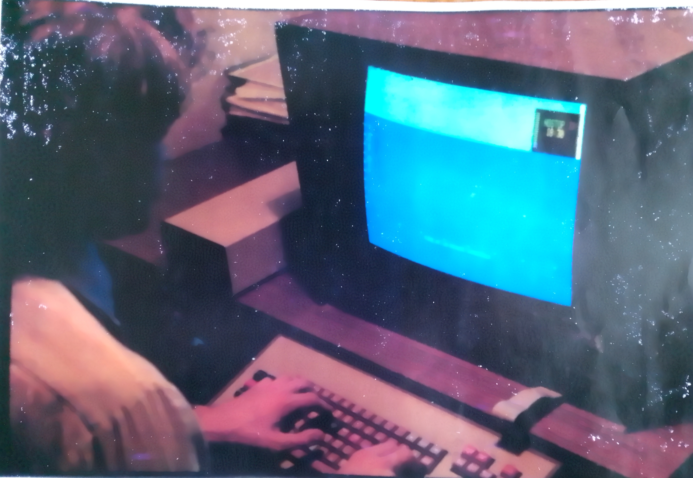
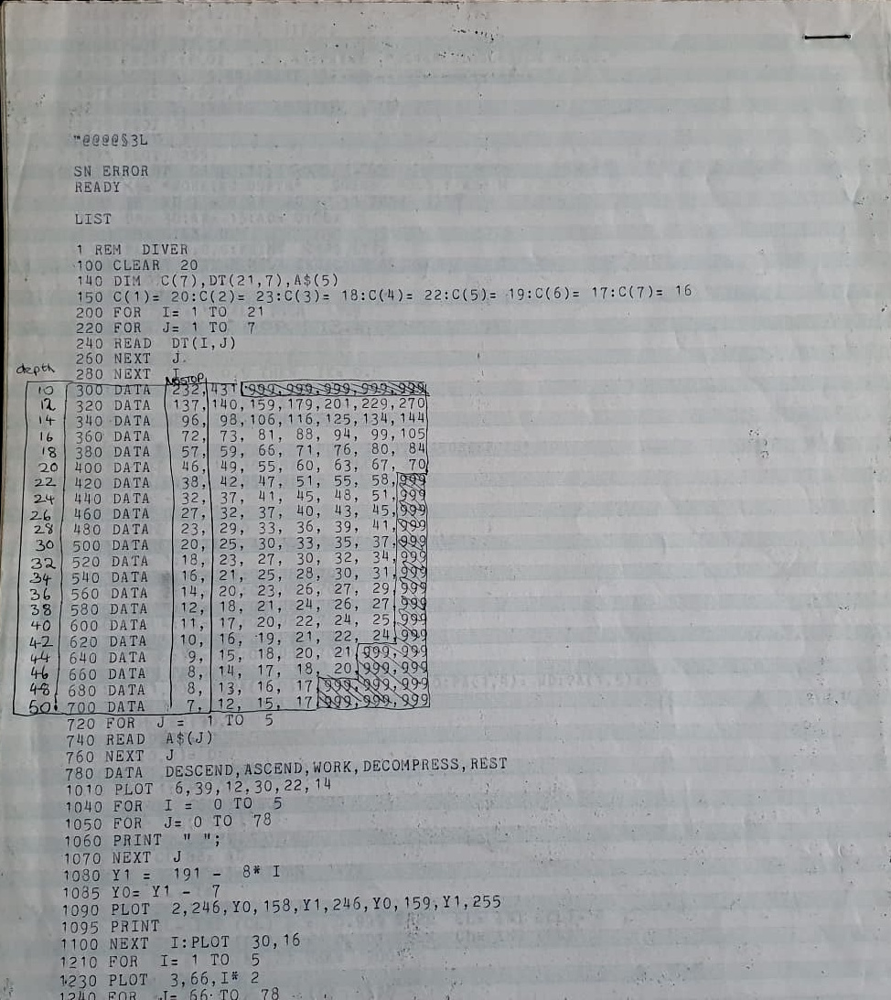
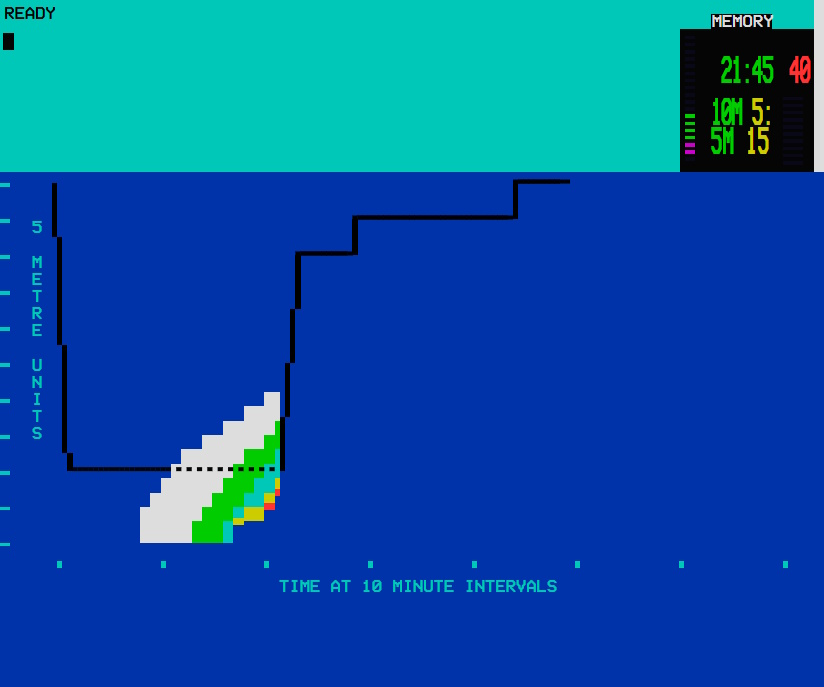

# DIVER Simulation Model: User Manual
*Based on DIVER.BAS (c. 1978–1979) | Designed by Dagfinn Aksnes & coded by Dr. George Mallen for Compucolor/Intecolor 8001 hardware.*  
*Reconstruction and Manual by John Dunlop, 2026.*

*Figure 1: Dr George Mallen operating the DIVER simulation software at the Royal College of Art (1979).*

*Figure 2: A photograph of the original 1978/79 paper listing sheets used as the source for the transcription.*

---

### ⚠️ WARNING: HISTORICAL DEMONSTRATION ONLY
This simulation is for educational and historical demonstration purposes only. The decompression model is derived from a late-1970s computer program and is **NOT** validated for operational dive planning...

---

## 1. Introduction
The Diver Simulation Model is a browser-based reconstruction, written in React/JSX, of `DIVER.BAS`, an innovative diving simulation written for Dagfinn Aksnes' MDes degree project at the Royal College of Art. The source machine has been identified through its unique `PLOT` commands and archival 1979 photographs as part of the Compucolor/Intecolor (CCI) 8001 family. 

This reconstruction preserves the original listing's code and logic in its entirety. The interface leverages an activity scheduler capable of advanced asynchronous queuing - asking for the next activity before the current one finishes.

## 2. Screen Layout & Interface
The display is rendered in a 480 × 400 logical SVG coordinate system, splitting the terminal into a **Cyan Input Band** across the top and a **Deep Blue Main Display Area** below.

*Figure 3: The modern React/JSX browser-based reconstruction showing a completed run profile.*

### 2.1 The Input Band
All operator interaction occurs here with a terminal-style flashing block cursor.
* **Numeric Validation:** Invalid entries trigger a persistent warning tone and clear the input before repeating the prompt. No text error message is displayed.
* **Text Normalisation:** Word inputs are automatically converted to upper case.

### 2.2 The Dive Monitor
Positioned at the upper right of the input band, this module updates continuously in real-time during a dive:
* **Actual Depth:** Displayed constantly in **red** text.
* **Depth Gauge:** A **red, rippling** block pattern visible *only* when the diver is actively ascending or descending.
* **Air Indicator:** A segmented vertical bar on the left (14 green segments, 2 magenta). Segments extinguish at a fixed rate over time regardless of activity. The simulation does not terminate when air empties; it is a conceptual air model.

## 3. Operating Instructions

### 3.1 Startup Prompts
Executed once sequentially before dive progression begins:
1. `WORKING DEPTH`: Must be a number between `1` and `49` (metres). This selection dynamically alters the mathematical spacing of the elapsed time tick marks on the graph below.
2. `TIME MODE (REAL OR ACCELERATED)`: Typing `REAL` runs the simulation at half-speed. Pressing Return or typing anything else defaults to `ACCELERATED` mode (running 8x faster than REAL mode).

### 3.2 Activity Selection Prompt
`WHICH ACTIVITY REQUIRED ([Suggested])` recurs throughout the dive. The scheduler prompts you with its default path in brackets; pressing **Return** automatically accepts it. You may type an alternative activity to override and queue it.

### 3.3 Mid-Dive Activities & Specific Prompts
* **DESCEND:** Automatically targets the pre-selected working depth. 
* **WORK:** Prompts the user for a `BOTTOM TIME` (in minutes). Long, deep dives are divided into discrete stages. The program will pause between stages and prompt: `IS NEXT STAGE = [n] MIN. REQUIRED`. Pressing **Return** accepts the added time; typing `NO` declines it and schedules an ascent. Entering a `0` or negative value for bottom time automatically replaces WORK with ASCEND.
* **ASCEND:** Moves the diver upward to either an intermediate decompression stop depth or directly to the surface.
* **DECOMPRESS:** Automatically schedules the diver to halt at a decompression station. 10m stops are locked at 5 minutes; 5m stops count down dynamically between 5 and 30 minutes based on the dive table.
* **REST:** Prompts the operator `FOR HOW LONG`. This acts as the terminal step to safely conclude a successful simulation.

## 4. Visualizing Decompression Behaviour
The system implements a historical Royal Navy air-diving decompression table. 

### 4.1 The Dive Monitor Readouts
* **Status Field:** Toggles between green (`NOSTOP`, `ASCEND`) and magenta (`STOP10`, `STOP5`) to alert the diver instantly to an active decompression obligation.
* **Time Field (Yellow):** 
  * During *WORK*, it displays a running forecast of the 5-metre stop duration the diver will face if they choose to ascend immediately.
  * **Advance Transition Warning:** Right before this forecast increments (e.g., jumping from 15 to 20 minutes), the field flashes an alert combining the current and impending values: `T15>20`.
  * During *DECOMPRESS*, it turns into a live countdown clock.
* **Additional Information:** Previews upcoming shallow steps (e.g., `5M 15:`) while the diver is still holding at a deeper 10m stop.

### 4.2 The Graph Colour Bands
As WORK progresses, the program paints columns of block graphics under the profile trace to map your decompression debt against the table:
* **White:** No current obligation, but rapidly approaching the `NOSTOP` limit.
* **Green ➔ Cyan ➔ Yellow:** Escalating decompression obligation.
* **Red:** Significant decompression obligation.
* **Black:** The maximum safety threshold supported by the built-in table.
* *Note:* Exceeding the black limit stops rendering bands altogether. Remaining out of table bounds entirely will eventually lock up the system with an `OUT OF RANGE` fault.

## 5. Dive Completion & MEMORY Mode
Once the `REST` phase completes, the terminal outputs `READY` in the input band and shifts the Dive Monitor into an institutional **MEMORY** mode. The real-time fields are frozen and reformatted into a structured post-dive summary:
* **Status Field:** Displays total elapsed dive time (e.g., `21:45`).
* **Depth Field:** Captures maximum depth achieved (e.g., `40`).
* **Time Field:** Displays the locked duration spent at 10 metres, labelled `10M`.
* **Additional Info Field:** Displays the locked duration spent at 5 metres, labelled `5M`.
