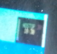
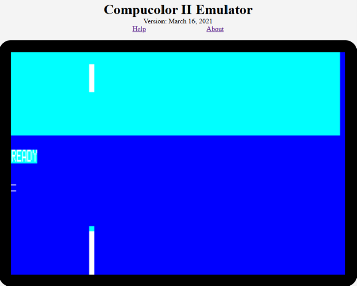
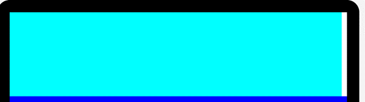

# T02 — FRAME Bar Position Testing
# reference/jsx_experiments/T02_frame_position.md
# June 2026
# ─────────────────────────────────────────────────────────────────

## Hardware context

The hardware platform running DIVER.BAS in 1979 is not definitively
confirmed, but the evidence points to the Compucolor family. The
Compucolor II was initially considered and appeared to suit in many
respects, but the physical form did not match the 1979 photographs.
The Compucolor 8001 was investigated next and shows a better match,
particularly for interpreting the PLOT command behaviour.

An emulator for the Compucolor II (60×24 character rows) is available
at: https://www.compucolor.org/emu/ccemu.html

## BASIC source — lines 1010, 1040–1100

```
1010 PLOT 6,39,12,30,22,14

1040 FOR I = 0 TO 5
1050   FOR J= 0 TO 78
1060     PRINT " ";
1070   NEXT J
1080   Y1 = 191 - 8 * I
1085   YO = Y1 - 7
1090   PLOT 2,246,YO,158,Y1,246,YO,159,Y1,255
1095   PRINT
1100 NEXT I: PLOT 30,16
```

T02 is early in the display setup. The core logic is one PLOT command
(line 1090) repeated 6 times at slightly different Y positions,
interspersed with PRINT space loops.

## Investigation

The element has no description in the BASIC source and is hard to
explain both visually and computationally. Because of an early
interpretation as two vertical white bars in the middle of the screen,
it was locally named FRAME. It was variously described as two bars,
one bar, or bars at other positions.

The element was not initially visible in the 1979 photographs. Once
the emulator produced a clear candidate image, a potential match was
found in the top-left of the screen in one photograph, adjacent to
the Display Monitor box.


*Emulator output — initial rendering of T02 FRAME element.*

Testing began with the plain PLOT, adjusting parameters from an
80-character row to 64. This confirmed the element as a single white
bar, not two bars.


*Emulator output — single white bar confirmed.*

Searching the 1979 photographs, only one showed anything resembling
the FRAME element: a feature in the top-left corner, adjacent to the
Display Monitor.


*1979 photograph — candidate FRAME position, top-left, adjacent to DM box.*

The parameters were adjusted to place the bar at that position,
working alongside the already-positioned cyan area and Display Monitor.
The bar fitted well.


*Emulator output — FRAME bar positioned at confirmed location.*

## Test listing (adjusted parameters)

```
1010 PLOT 6,39,12,30,22,14

1040 FOR I = 0 TO 5
1050   FOR J= 0 TO 62
1060     PRINT " ";
1070   NEXT J
1080   Y1 = 127 - 8 * I
1085   YO = Y1 - 7
1090   PLOT 2,246,YO,126,Y1,246,YO,127,Y1,255
1095   PRINT
1100 NEXT I
1110 END
```

## Conclusions

- FRAME is a single white vertical bar, not two bars.
- Position confirmed by photograph: top-left of screen, flush to the
  right edge of the Display Monitor box (col 79, SVG x=474).
- Height: stops at the cyan/blue boundary (SVG y=96, text domain).
- Hypothesis: the white bar creates a 3-D shadow effect, making the
  Display Monitor box appear raised from the screen surface.
- PLOT 2 behaviour (Y Bar Graph submode) not yet fully reconciled
  with the 8001 manual. See LOG and U03.
