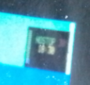
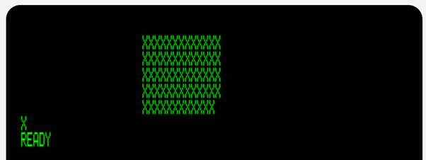

# T03 — Display Monitor Box Solid Rectangle Testing
# reference/jsx_experiments/T03_dm_box.md
# June 2026
# ─────────────────────────────────────────────────────────────────

## Hardware context

The hardware platform running DIVER.BAS in 1979 is not definitively
confirmed, but the evidence points to the Compucolor family. The
Compucolor II was initially considered and appeared to suit in many
respects, but the physical form did not match the 1979 photographs.
The Compucolor 8001 was investigated next and shows a better match,
particularly for interpreting the PLOT command behaviour.

An emulator for the Compucolor II (60×24 character rows) is available
at: https://www.compucolor.org/emu/ccemu.html

## BASIC source — lines 1100, 1210–1260

```
1100 NEXT I: PLOT 30,16

1210 FOR I = 1 TO 5
1230   PLOT 3,66,I * 2
1240   FOR J= 66 TO 78
1250     PRINT " ";
1255   NEXT J
1260 NEXT I
```

Note: the `NEXT I` at line 1100 is the close of the T02 loop and
plays no part in this test. T03 begins with `PLOT 30,16`.

T03 is also early in the display setup. It is locally named the
Display Monitor box — it shows parameters to be monitored and checked
throughout the dive simulation. It is visible (sometimes unclearly)
in all surviving 1979 photographs and its outline never changes. Later
tests examine how its content changes during the simulation.


*1979 photograph — Display Monitor box visible in cyan area, top-right.*

## Investigation

A natural first reading of the code suggests 6 black rows in 12
stripes — much larger than shown in the photographs and not a coherent
block, due to the `I*2` cursor coordinate placing characters on even
rows only (rows 2, 4, 6, 8, 10). The BASIC code is difficult to
interpret any other way from the source alone.

At the time of testing, `PLOT 30,16` was understood only as "change
to black background." The emulator revealed a wider definition.

Exploring `PLOT 30,n` for neighbouring values:
- `PLOT 30,15`: small (normal) characters, black background
- `PLOT 30,14`: small characters, red background
- `PLOT 30,16`: **double-height characters**, black background

With double-height characters active, each printed row occupies two
character rows. The even-row cursor positioning (`I*2`) combined with
double-height output fills the intervening rows, producing 5
contiguous rows — a solid black rectangle.


*Emulator output — solid black rectangle confirmed. The spurious
character on a new line is believed to be an emulator artefact.*

This matches all 1979 photographs.

## Test listing

```
10   PLOT 12

1100 PLOT 30,16

1210 FOR I = 1 TO 5
1230   PLOT 3,20,I * 2
1240   FOR J= 20 TO 32
1250     PRINT "X";
1251     REM INPUT X$
1255   NEXT J
1260 NEXT I

1262 PRINT;
```

`PLOT 12` clears the emulator screen for clarity. `PRINT "X"` used
in place of `PRINT " "` to make character placement visible.
`REM INPUT X$` is a disabled pause — left in for reference.

## Conclusions

- `PLOT 30,16` sets double-height characters (not merely black
  background as previously assumed).
- Double-height output with `I*2` even-row cursor positioning
  produces 5 contiguous rows — a solid black rectangle.
- This matches all 1979 photographs. No alternative mechanism needed.
- `PRINT " ";` semicolon is essential: without it characters advance
  to the next line and the rectangle does not form. The semicolon
  was missing from the original BASIC transcription and was found
  by this emulator test.
- U10 remains open: why `I*2` with double-height characters produces
  contiguous rows (rather than leaving gaps at odd rows) is not yet
  mechanically explained. The result is confirmed; the mechanism is not.
- Confirmed DM box geometry: DM_X=396 (col 66 × 6px), DM_W=78
  (13 cols × 6px), DM_Y=16 (row 1 × 16px), DM_H=80 (5 rows × 16px).
  See CoordinateSystem.md.
